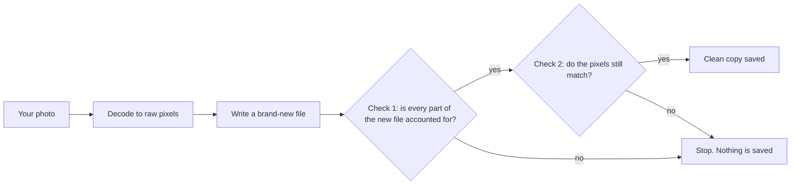

<div align="center">

# 🧼 imgstrip

**Share the picture. Keep everything else to yourself.**

Photos quietly carry your location, your camera, the time you took them, and sometimes more.
`imgstrip` removes all of it, then checks its own work before it saves anything.


[Quick start](#-quick-start) · [How it works](#-how-it-works) · [Everyday use](#-everyday-use) · [Web app](#-web-app) · [Good to know](#-good-to-know)

</div>

---

## Why imgstrip?

Most metadata removers delete the tags they recognize and copy the rest of the file untouched. Anything they don't recognize survives.

imgstrip works the other way around. It reads only the **pixels** and builds a **brand-new file** from them. By default nothing from the old file is copied over, so there is nothing left to leak. (The opt-in JPEG options `--jpeg-lossless`, `--jpeg-canonical` and `--scrub-dct` keep some of the picture's compressed data; see "Good to know" below.)

```console
$ imgstrip --check holiday.jpg
FOUND    holiday.jpg (JPEG 640x480): 4 item(s)
           [metadata] EXIF: make=NIKON, model=COOLPIX P6000, date=2008:10:22 16:28:39
           [metadata] GPS location: 43.467448, 11.885127
           [hidden]   Embedded EXIF thumbnail: 6702 bytes
           [metadata] XMP: 4000 bytes

$ imgstrip holiday.jpg
cleaned  holiday.jpg -> holiday.clean.jpg
           removed: EXIF, GPS location, Embedded EXIF thumbnail, XMP

$ imgstrip --check holiday.clean.jpg
clean    holiday.clean.jpg (JPEG 640x480)
```

Your original file is never touched. The clean copy is saved next to it.

## 🚀 Quick start

You need **Python 3.10 or newer**.

```console
pip install imgstrip
```

Prefer to keep it out of your main Python setup? `pipx install imgstrip` works too.

Then try it:

```console
imgstrip photo.jpg          # writes photo.clean.jpg
imgstrip-web                # or use the point-and-click web app
```

Want to be sure the install works? Run `imgstrip --self-test`. It builds 21 booby-trapped test images, cleans them in every mode, and has independent image readers confirm the results.

<details>
<summary>Install from source instead</summary>

```console
git clone https://github.com/lloydsato/imgstrip.git
cd imgstrip
pip install .
```

</details>

## 🔍 How it works



If either check fails, **nothing is written**. Failing safe is the whole point.

(If you're reading this on PyPI and the diagram shows as plain text, the [GitHub page](https://github.com/lloydsato/imgstrip#-how-it-works) renders it.)

## 🛠 Everyday use

| I want to... | Run |
|---|---|
| See what a photo gives away, without changing it | `imgstrip --check photo.jpg` |
| Clean one photo | `imgstrip photo.jpg` |
| Clean a whole folder, including subfolders | `imgstrip -r my-photos/ -o clean-photos/` |
| Replace the originals with clean versions | `imgstrip -i photo.jpg` |
| Give outputs random names (file names can leak dates) | `imgstrip --random-name photo.jpg` |
| Clean a JPEG with no quality loss at all | `imgstrip --jpeg-lossless photo.jpg` |
| Convert while cleaning | `imgstrip --format png photo.jpg` |
| Preview what would happen, write nothing | `imgstrip -n photo.jpg` |

Run `imgstrip --help` to see every option.

### Going further

| Switch | What it does |
|---|---|
| `--deep` | Also scans the pixels for signs of hidden data (LSB steganography). |
| `--scrub-lsb` | Randomizes the least-significant bit of every pixel value, which destroys hidden LSB messages. The change is invisible (at most 1/255). |
| `--jpeg-canonical` | JPEG only. Rebuilds the compressed data in one canonical form so nothing can hide in table layouts, padding or markers. The picture stays pixel-identical. |
| `--scrub-dct` | JPEG only. Also destroys steganography stored in the parity of the JPEG's DCT coefficients (JSteg, F5, steghide, J-UNIWARD...); payloads kept in higher bits are not covered. This costs picture quality, so the report says how much. Off unless you ask. |
| `--scrub-prnu` | Disrupts your camera's sensor fingerprint, a pattern in the pixels themselves that can link a photo to a specific camera. Moves parts of the picture by a few pixels. |
| `--icc sanitize` | Keeps the exact colors using a rebuilt, anonymous color profile. |
| `--c2pa` | Signs each clean image with a Content Credential, so you can show it was sanitized without being altered. Needs the optional extra: `pip install 'imgstrip[c2pa]'`. |

## 🖥 Web app

```console
imgstrip-web
```

Drop photos onto the window and each one shows what it gives away. Click **Clean**, then download the results one by one, as a ZIP, or save them straight to a folder.

<div align="center">
  
</div>

Open **Options** for the same switches as the command line: *Deep scan*, *Keep JPEG data bit-exact*, *Scrub least-significant bits*, *Disrupt camera fingerprint*, *Sign with Content Credentials*, plus the output format, quality and colour profile.

- Runs **only on your computer** (`127.0.0.1`) and works offline.
- Your originals are **never written to disk**, and nothing is uploaded anywhere.
- On a shared computer, start it with `imgstrip-web --no-browser` and open the printed link yourself.

## 📁 What it handles

| | Formats |
|---|---|
| **Everyday photos** | JPEG, PNG, WebP, GIF (animated too), HEIC/HEIF (iPhone), AVIF |
| **Also supported** | TIFF, BMP, and ICO, PSD, TGA, QOI, JPEG 2000 and other less common formats (these come out as PNG) |
| **Not supported** | Camera RAW files (DNG, CR2, NEF, ARW...). Export to JPEG, PNG or TIFF first. Vector formats (SVG, PDF, EPS) are also unsupported. |

Removed: EXIF, GPS, XMP, IPTC, comments, camera serial numbers, embedded thumbnails, depth maps, color profiles that name your device, data tacked on after the image, and colors hidden under transparent pixels.

## ⚠️ Good to know

No tool can do everything, and it's better to know the limits up front.

- **What's in the picture stays.** Faces, street signs, reflections and landmarks can reveal more than any tag.
- **Your camera's sensor fingerprint stays** unless you use `--scrub-prnu`. Even then, nobody can prove it's gone, and the scrub is not reliable against anyone who holds another photo of the same scene (a thumbnail, a second shot, the original document). Its strength was measured in simulation, not on real cameras, and it costs about 20 dB PSNR against the original; text can shift by several pixels.
- **File names can leak dates** (`IMG_20240517_133700.jpg`). Use `--random-name` (the web app has a Random file names switch).
- **`--check` is a structural check, not proof.** It lists what a file's container holds. It does not look inside compressed picture data, so it cannot see data hidden in JPEG image data or in the pixels (use `--deep` for the pixel tests).
- **A clean scan isn't proof.** "Not detected" means the tests found nothing, not that nothing is hidden.
- **Invisible watermarks** built to survive re-saving (such as SynthID) live in the picture itself and may survive.
- **JPEGs are re-encoded** (quality 95) by default. Use `--jpeg-lossless` to avoid any quality loss. That mode keeps the compressed picture data exactly as it was, so it doesn't clear steganography hidden in the image data itself, and it is meant for pictures you trust, not as a fix for a file the default mode refused. It does drop tables nothing uses and refuses a file that carries bytes no decoder reads. Re-encoding doesn't reliably clear it either: hiding tools that change zero coefficients mostly survive. `--scrub-dct` is built for that and destroys payloads read from the DCT coefficients, at a cost of roughly 33 to 39 dB of picture quality against the original. It never claims that nothing is hidden. See [how it works](https://github.com/lloydsato/imgstrip/blob/main/docs/DCT_WORKFLOW.md).
- **`-i` is not a secure erase.** Old copies can linger in backups, cloud sync history and SSD wear-leveling.
- **Very grainy JPEGs may be refused** by the default mode because the re-encoded copy would drift too far from the original, and imgstrip would rather refuse than save something it couldn't verify. Use `--jpeg-canonical` for those (same pixels, rebuilt in one canonical form).

## 📚 Learn more

The full technical reference covers every option, the exact list of what gets removed, how the sensor-fingerprint scrub was measured, optional **Content Credentials (C2PA)** signing for journalists, and how the project is tested:

➡️ **[Technical reference](https://github.com/lloydsato/imgstrip/blob/main/docs/REFERENCE.md)**

## 🧪 Development

```console
pip install -e '.[test]'
pytest
```

## 📄 License

imgstrip is free software, released under the [GNU Affero General Public License v3.0 or later](https://github.com/lloydsato/imgstrip/blob/main/LICENSE). If you modify it and offer it to others over a network, the AGPL requires you to share your changes under the same license.

Questions, bug reports and odd files that break it are welcome in the [issue tracker](https://github.com/lloydsato/imgstrip/issues).
