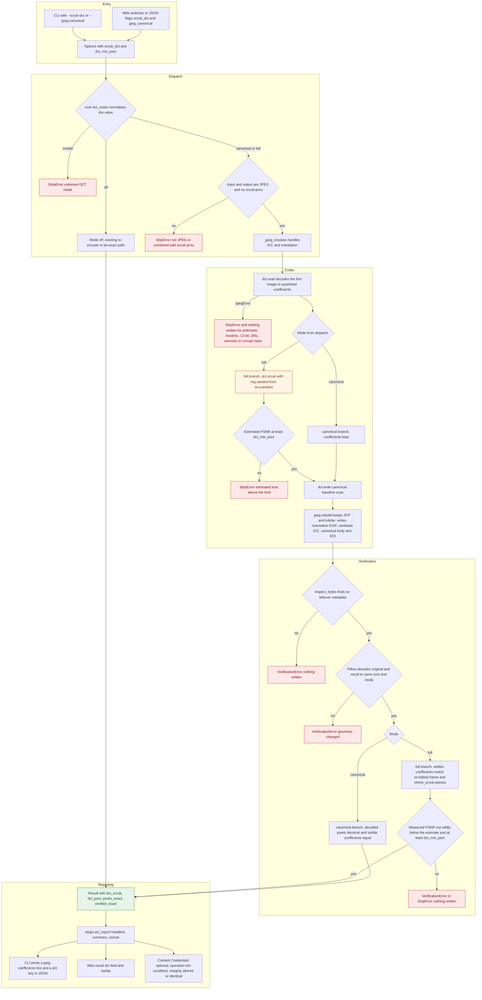
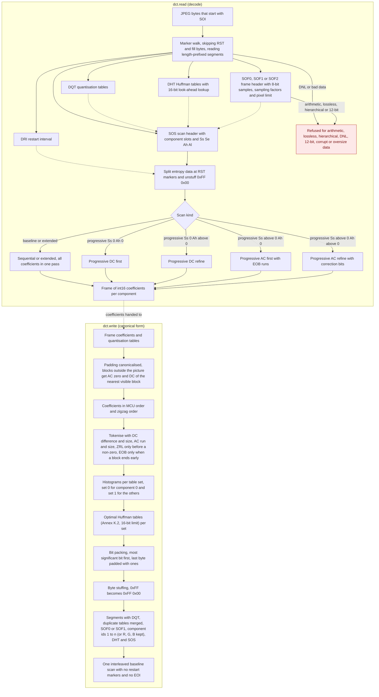
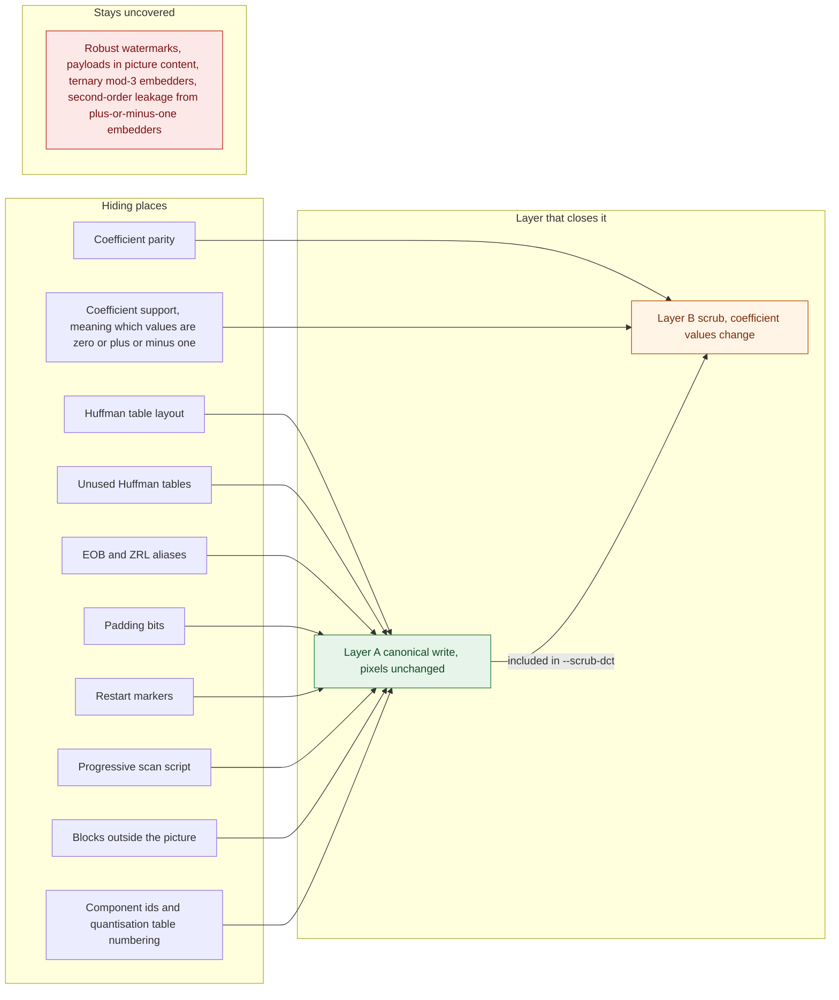

# JPEG coefficient workflow

imgstrip's JPEG coefficient options work on the quantised DCT coefficients inside a JPEG, where steganography tools such as JSteg, OutGuess, steghide, F5 and J-UNIWARD hide data. `--jpeg-canonical` rebuilds the file in one canonical form and leaves the pixels unchanged, and `--scrub-dct` adds a scrub of the coefficient values that costs picture quality. Both are opt-in and off by default. The diagrams below follow one run from the entry point to the reported result.

### A. End-to-end workflow

An option set from the CLI or the web API reaches `core.dct_mode`, which returns off, canonical or full. The JPEG path refuses inputs or outputs that are not JPEG and any combination with `--scrub-prnu`; when both CLI flags are given, `--scrub-dct` wins over `--jpeg-canonical`. Every red exit happens before a byte is written, and a result is returned only after the verification checks pass.

### B. Codec internals

`dct.read` is the codec's own decoder: it walks the markers, builds the Huffman lookup tables, and decodes each scan with the routine that matches its kind, splitting entropy data at restart markers first. `dct.write` runs the other way and throws away every encoder choice: it canonicalises the padding blocks, tokenises each block, builds optimal Huffman tables for two table sets, and packs the bits into one interleaved baseline scan. Because the output depends only on the coefficients, the quantisation tables and the geometry, the original encoder's table layout, padding and markers do not survive.

### C. What each layer closes

Layer A, the canonical write, closes every hiding place around the coefficients and leaves the decoded pixels unchanged, so `--jpeg-canonical` costs nothing in picture quality but keeps the coefficients. Layer B, which only `--scrub-dct` runs (after Layer A), closes the two channels that live in the coefficient values themselves: their parity, and the support pattern used by zero-changing embedders such as J-UNIWARD. The red node is the honest limit: robust watermarks, payloads carried by the picture content, ternary embedders and the leak of plus-or-minus-one embedders at the edge of the zero zone (finding F5: about 0.08 bit per carrier for a receiver who knows the carrier positions, see the reference) are outside what the guarantee covers.

### D. Verification sequence

```mermaid
sequenceDiagram
    participant U as User
    participant K as core
    participant D as dct
    participant P as Pillow
    participant J as jpeg.rebuild
    U->>K: strip with scrub_dct full
    K->>K: dct_mode full and input and output are JPEG
    K->>D: read data with pixel limit
    alt not representable or corrupt
        D-->>K: JpegError
        K-->>U: StripError nothing written
    else decoded
        D-->>K: Frame
        K->>D: scrub frame with rng seeded from os.urandom
        D-->>K: ScrubStats with estimated PSNR
        alt estimate below dct_min_psnr
            K-->>U: StripError nothing written
        else estimate acceptable
            K->>D: write frame
            D-->>K: canonical body
            K->>J: rebuild with orientation ICC and canonical body
            J-->>K: clean JPEG and count of dropped images
            K->>K: inspect_bytes leftover check
            K->>P: decode original and result
            P-->>K: same size and mode
            K->>D: read result
            D-->>K: written Frame
            K->>K: written coefficients equal scrubbed frame and check_scrub passes
            K->>P: decoded arrays for real PSNR
            P-->>K: pixel arrays
            alt real PSNR more than 10 dB below estimate
                K-->>U: VerificationError nothing written
            else real PSNR below dct_min_psnr
                K-->>U: StripError nothing written
            else all checks pass
                K-->>U: Result with dct_scrub scrubbed and dct_psnr
            end
        end
    end
```

A full-mode run reads the input, scrubs the coefficients, writes the canonical form, and then re-reads the written file and checks it against what the scrub promised before anything is returned. The floor is checked twice: on the estimate before writing, and on the PSNR measured from decoded pixels after writing, and the measured value must not fall more than 10 dB below the estimate (the estimate averages error over whole blocks, so it is loose for tiny pictures; the exact coefficient comparison is the strict check). Canonical mode follows the same path but compares decoded pixels and visible coefficients exactly, and any mismatch is a hard failure with nothing written.

## Reading guide

- `src/imgstrip/core.py`: `dct_mode` (normalisation), `_Job._run` (dispatch and refusals), `_jpeg_lossless` (headers and the structural and pixel checks), `_dct_body` (read, scrub, floor, write) and `_verify_dct_scrub` (scrub checks).
- `src/imgstrip/dct.py`: `read` and its scan decoders, `write` with `canonicalise_padding`, `scrub`, `check_scrub` and `psnr`.
- `src/imgstrip/jpeg.py`: `rebuild`, which writes the headers around the canonical body and drops everything else.
- `src/imgstrip/stego.py`: `dct_report`, the wording shared by the CLI, the web app and JSON.
- `src/imgstrip/cli.py` (`options_from_args`; `--dct-min-psnr` defaults to 25 dB, 0 disables) and `src/imgstrip/web/server.py` (`parse_options`). The web API has no PSNR switch, so web runs always use the default floor.
- `src/imgstrip/credentials.py`: records `dct-scrubbed` and sets the integrity claim from a pixel comparison.
- `tests/test_dct_codec.py`, `tests/test_dct_canonical.py`, `tests/test_dct_scrub.py`, `tests/test_dct_edge_cases.py` and `tests/test_dct_surfaces.py`: the tests for the codec, Layer A, Layer B, the edge cases, and the command line, web API and reports. `tests/jpeg_craft.py` and `tests/dct_embedders.py` are the reference encoder (every covert-channel knob) and the reference steganography tools they use.

Cost and limits: the full scrub costs picture quality. The measured figures quoted for this feature are roughly 29 to 39 dB PSNR against the input, with files typically 40 to 70 percent smaller. Canonical mode costs nothing in pixels. Neither mode proves that nothing is hidden; the guarantee covers payloads read from coefficient parity or support, as described in section C.
