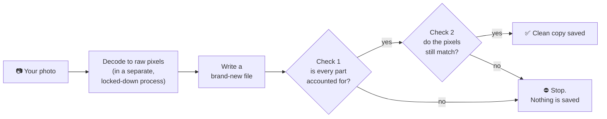

<!-- template-only
  README.md is GENERATED from this file by scripts/render_readme.py. Edit this template, never README.md.
  This comment is dropped when the README is rendered.
  Placeholders (filled from the files that own them): {{VERSION}}, {{VERSION_BADGE}}, {{PYTHON_MIN}}.
  Use absolute URLs for images and docs links: PyPI shows the rendered README too, and relative paths break there.
-->
<div align="center">


<br>

[](https://pypi.org/project/imgstrip/)
[](https://pypi.org/project/imgstrip/)
[](https://github.com/lloydsato/imgstrip/blob/main/LICENSE)
[](https://github.com/lloydsato/imgstrip/actions/workflows/ci.yml)


**Photos quietly carry your location, your camera, the time you took them, and sometimes more.**<br>
`imgstrip` removes all of it, then checks its own work before it saves anything.

[Quick start](#quick-start) · [How it works](#how-it-works) · [Which switch?](#which-switch-do-i-need) · [Everyday use](#everyday-use) · [Python](#use-it-from-python) · [Web app](#web-app) · [Limits](#good-to-know)

</div>

<br>

<table>
<tr>
<td width="50%" valign="top">
<b>🧱 Rebuilt from pixels</b><br>
It decodes the image, in a separate, locked-down process, and writes a brand-new file. By default only pixel values cross over, so there is nothing left to leak.
</td>
<td width="50%" valign="top">
<b>🔬 Checked twice</b><br>
A strict parser must account for every part of the new file, then the file is decoded again and compared with the pixels, by a second, independent reader too where one exists. If any check fails, <b>nothing is written</b>.
</td>
</tr>
<tr>
<td width="50%" valign="top">
<b>👀 Look before you clean</b><br>
See what a photo gives away first: location, camera, serial numbers, time taken, hidden previews. Nothing changes until you say so.
</td>
<td width="50%" valign="top">
<b>🕵️ Beyond metadata</b><br>
Data tacked on after the image, colour hidden under transparent pixels, and (opt-in) pixel and JPEG steganography and the camera's sensor fingerprint.
</td>
</tr>
<tr>
<td width="50%" valign="top">
<b>🔒 Private by design</b><br>
The web app runs only on your computer, works offline, never writes your originals to disk and uploads nothing.
</td>
<td width="50%" valign="top">
<b>🖼 Your formats</b><br>
JPEG, PNG, WebP, GIF (animated too), HEIC/HEIF, AVIF, TIFF and BMP, with 16-bit PNG and TIFF kept at full precision.
</td>
</tr>
</table>

## Why imgstrip?

Most metadata removers delete the tags they recognize and copy the rest of the file untouched. Anything they don't recognize survives.

imgstrip works the other way around. It reads only the **pixels** and builds a **brand-new file** from them. By default nothing from the old file is copied over, so there is nothing left to leak. (The opt-in JPEG options `--jpeg-lossless`, `--jpeg-canonical` and `--scrub-dct` keep some of the picture's compressed data; see [Good to know](#good-to-know) below.)

```console
$ imgstrip --check holiday.jpg
FOUND    holiday.jpg (JPEG 640x480): 4 item(s)
           [metadata] EXIF: make=NIKON, model=COOLPIX P6000, date=2008:10:22 16:28:39
           [metadata] GPS location: 43.467448, 11.885127
           [hidden]   Embedded EXIF thumbnail: 6702 bytes
           [metadata] XMP: 4000 bytes

$ imgstrip holiday.jpg
cleaned  holiday.jpg -> holiday.clean.jpg
           removed: EXIF, GPS location, Embedded EXIF thumbnail, XMP

$ imgstrip --check holiday.clean.jpg
clean    holiday.clean.jpg (JPEG 640x480)
```

Your original file is never touched. The clean copy is saved next to it.

## Quick start

You need **Python {{PYTHON_MIN}} or newer**.

```console
pip install imgstrip
```

Prefer to keep it out of your main Python setup? `pipx install imgstrip` and `uv tool install imgstrip` work too.

Then try it:

```console
imgstrip photo.jpg          # writes photo.clean.jpg
imgstrip-web                # or use the point-and-click web app
```

Check which version you have:

```console
$ imgstrip --version
imgstrip {{VERSION}}
```

Want to be sure the install works? Run `imgstrip --self-test`. It builds 21 booby-trapped test images, cleans them in every mode, and has independent image readers confirm the results.

<details>
<summary>Install from source instead, or add Content Credentials signing</summary>

```console
git clone https://github.com/lloydsato/imgstrip.git
cd imgstrip
pip install .
```

Signing cleaned images with a Content Credential (C2PA) is optional and needs an extra, because it brings a native library:

```console
pip install 'imgstrip[c2pa]'
```

</details>

## How it works



If either check fails, **nothing is written**. Failing safe is the whole point. The decoding runs in a fresh process for every file, which hands back only pixels and a few checked values and, on Linux and macOS, cannot write to files, so a hostile file that exploits a decoder bug is cut off from imgstrip's own memory and from the file it writes ([what it does and does not stop](docs/REFERENCE.md#decoding-in-a-sandbox); `--no-sandbox` turns it off).

(If you're reading this on PyPI and the diagram shows as plain text, the [GitHub page](https://github.com/lloydsato/imgstrip#how-it-works) renders it.)

## Which switch do I need?

The defaults already remove metadata, hidden containers and appended data. The switches below are for specific worries.

| If you're worried about... | Use | Cost |
|---|---|---|
| What a photo gives away (location, camera, dates) | `imgstrip photo.jpg` | JPEGs are re-encoded at quality 95 |
| A JPEG losing any quality at all | `--jpeg-lossless` | Keeps the compressed picture data as it was, so use it for pictures you trust |
| Data hidden in a JPEG's table layouts, padding or markers | `--jpeg-canonical` | Same pixels, rebuilt in one canonical form. DCT steganography survives |
| Messages hidden in the low bits of pixels (LSB) | `--scrub-lsb`<br>(look first with `--deep`) | Changes each value by at most 1/255. Invisible |
| Messages hidden in the transparency (alpha) layer of a PNG, WebP, GIF or TIFF | `--scrub-alpha`<br>(add `--scrub-lsb` for the colours too) | Pixels within 5/255 of solid or clear become exactly solid or clear. `--scrub-lsb` leaves alpha 0 and 255 alone, so it does not cover this |
| Messages hidden in a JPEG's DCT coefficients (JSteg, F5, steghide, J-UNIWARD...) | `--scrub-dct` | Costs picture quality. The report says how much |
| A photo being linked to your specific camera (sensor fingerprint) | `--scrub-prnu` | Moves parts of the picture by a few pixels. Strong reduction, never proof |
| Colours that must stay exact | `--icc sanitize` | Embeds a rebuilt, anonymous colour profile |
| Showing readers the image was sanitised, not altered | `--c2pa` | Needs `pip install 'imgstrip[c2pa]'` and a signing certificate |
| File names that leak dates (`IMG_20240517_133700.jpg`) | `--random-name` | None |

## Everyday use

| I want to... | Run |
|---|---|
| See what a photo gives away, without changing it | `imgstrip --check photo.jpg` |
| Clean one photo | `imgstrip photo.jpg` |
| Clean a whole folder, including subfolders | `imgstrip -r my-photos/ -o clean-photos/` |
| Replace the originals with clean versions | `imgstrip -i photo.jpg` |
| Give outputs random names | `imgstrip --random-name photo.jpg` |
| Clean a JPEG with no quality loss at all | `imgstrip --jpeg-lossless photo.jpg` |
| Convert while cleaning | `imgstrip --format png photo.jpg` |
| Preview what would happen, write nothing | `imgstrip -n photo.jpg` |
| Also search the pixels for hidden data | `imgstrip --check --deep photo.png` |
| Clean from a pipe | `cat a.heic \| imgstrip - --format jpeg > a.jpg` |

Run `imgstrip --help` to see every option.

### In scripts and CI

`--check` writes nothing and sets the exit status, so it works as a gate. Add `--json` for machine-readable output.

```console
imgstrip --check --json photo.jpg
imgstrip --check uploads/*.jpg || echo "something here would leak"
```

| Exit status | Meaning |
|---|---|
| `0` | Success, or (with `--check`) everything is clean |
| `1` | At least one file failed |
| `2` | Usage error |
| `3` | `--check` found metadata or hidden data |

## Use it from Python

```python
from imgstrip import Options, StripError, strip_image

with open("photo.jpg", "rb") as f:
    data = f.read()

try:
    result = strip_image(data, Options(scrub_lsb=True))
except StripError as exc:  # includes VerificationError: nothing was produced
    raise SystemExit(f"could not clean it safely: {exc}")

with open("photo.clean.jpg", "wb") as f:
    f.write(result.data)

print([str(item) for item in result.removed])
```

The engine is the same one the command line and the web app use, so it makes the same checks and fails the same way.

## Web app

```console
imgstrip-web
```

Drop photos onto the window and each one shows what it gives away, with its SHA-256 and MD5. Pick a photo to see the details beside the list. Click **Clean**, and every row then shows the hashes before and after; download the results one by one, as a ZIP, or save them straight to a folder. A hash list (CSV) and a box to compare a hash you already have are in the same place.

<div align="center">
  
</div>

Open **Options** for the same switches as the command line (*Deep scan* sits next to the Clean button), and press the (i) beside any of them for an explanation in plain words: *Deep scan*, *Keep JPEG data bit-exact*, *Scrub least-significant bits*, *Clean transparency channel*, *Disrupt camera fingerprint*, *Sign with Content Credentials*, plus the output format, quality and colour profile.

Options that do not apply to the images you added are greyed out, and ones that cannot be done for them are greyed out with a yellow warning triangle and the reason.

- Runs **only on your computer** (`127.0.0.1`) and works offline.
- Your originals are **never written to disk**, and nothing is uploaded anywhere.
- On a shared computer, start it with `imgstrip-web --no-browser` and open the printed link yourself.

## What it handles

| | Formats |
|---|---|
| **Everyday photos** | JPEG, PNG, WebP, GIF (animated too), HEIC/HEIF (iPhone), AVIF |
| **Also supported** | TIFF, BMP, and ICO, PSD, TGA, QOI, JPEG 2000 and other less common formats (these come out as PNG) |
| **Not supported** | Camera RAW files (DNG, CR2, NEF, ARW...). Export to JPEG, PNG or TIFF first. Vector formats (SVG, PDF, EPS) are also unsupported. |

Removed: EXIF, GPS, XMP, IPTC, comments, camera serial numbers, embedded thumbnails, depth maps, color profiles that name your device, data tacked on after the image, and colors hidden under transparent pixels.

## Good to know

No tool can do everything, and it's better to know the limits up front.

- **What's in the picture stays.** Faces, street signs, reflections and landmarks can reveal more than any tag.
- **Your camera's sensor fingerprint stays** unless you use `--scrub-prnu`. Even then, nobody can prove it's gone, and the scrub is not reliable against anyone who holds another photo of the same scene (a thumbnail, a second shot, the original document). Its strength was measured in simulation, not on real cameras, and it costs about 20 dB PSNR against the original; text can shift by several pixels.
- **File names can leak dates** (`IMG_20240517_133700.jpg`). Use `--random-name` (the web app has a Random file names switch).
- **`--check` is a structural check, not proof.** It lists what a file's container holds. It does not look inside compressed picture data, so it cannot see data hidden in JPEG image data or in the pixels (use `--deep` for the pixel tests).
- **A clean scan isn't proof.** "Not detected" means the tests found nothing, not that nothing is hidden.
- **Invisible watermarks** built to survive re-saving (such as SynthID) live in the picture itself and may survive.
- **JPEGs are re-encoded** (quality 95) by default. Use `--jpeg-lossless` to avoid any quality loss. That mode keeps the compressed picture data exactly as it was, so it doesn't clear steganography hidden in the image data itself, and it is meant for pictures you trust, not as a fix for a file the default mode refused. It does drop tables nothing uses and refuses a file that carries bytes no decoder reads. Re-encoding doesn't reliably clear it either: hiding tools that change zero coefficients mostly survive. `--scrub-dct` is built for that: it destroys payloads read from the parity of the DCT coefficients and greatly weakens ±1 ones (a receiver who already knows where the bits sit can still read a small part, about 0.08 bit per carrier), at a cost of roughly 33 to 39 dB of picture quality against the original. It never claims that nothing is hidden. See [how it works](https://github.com/lloydsato/imgstrip/blob/main/docs/DCT_WORKFLOW.md).
- **`-i` is not a secure erase.** Old copies can linger in backups, cloud sync history and SSD wear-leveling.
- **Very grainy JPEGs may be refused** by the default mode because the re-encoded copy would drift too far from the original, and imgstrip would rather refuse than save something it couldn't verify. For lossy formats the check also bounds the error of every 8 x 8 block, so a change to a small part of the picture is caught as well as a change to all of it. Use `--jpeg-canonical` for those (same pixels, rebuilt in one canonical form).

## Learn more

The full technical reference covers every option, the exact list of what gets removed, how the sensor-fingerprint scrub was measured, optional **Content Credentials (C2PA)** signing for journalists, and how the project is tested.

| Read | What's in it |
|---|---|
| 📘 [Technical reference](https://github.com/lloydsato/imgstrip/blob/main/docs/REFERENCE.md) | Every option, what gets removed and what changes, supported formats, how it is tested |
| 🧬 [JPEG steganography workflow](https://github.com/lloydsato/imgstrip/blob/main/docs/DCT_WORKFLOW.md) | When and how to use `--jpeg-canonical` and `--scrub-dct` |
| 🛰 [Sensor fingerprint (PRNU)](https://github.com/lloydsato/imgstrip/blob/main/docs/REFERENCE.md#camera-sensor-fingerprint-prnu) | What `--scrub-prnu` does and how well it works, measured |
| 🪪 [Content Credentials (C2PA)](https://github.com/lloydsato/imgstrip/blob/main/docs/REFERENCE.md#content-credentials-c2pa-optional) | Signing sanitised images, trust, and what a credential can and cannot say |

## Development

```console
git clone https://github.com/lloydsato/imgstrip.git
cd imgstrip
pip install -e '.[test]'
pytest
```

**The version lives in one place:** `__version__` in `src/imgstrip/__init__.py`. The packaging reads it from there, and so does this page: `README.md` is generated from [`docs/README.template.md`](https://github.com/lloydsato/imgstrip/blob/main/docs/README.template.md) by `scripts/render_readme.py`. After a version bump, CI refreshes the README on `main`; to do it by hand, run `python scripts/render_readme.py` (add `--check` to only verify). Edit the template, never the generated file.

## License

imgstrip is free software, released under the [BSD 3-Clause License](https://github.com/lloydsato/imgstrip/blob/main/LICENSE).

Versions up to 1.2.0 were released under the GNU Affero General Public License v3.0 or later; 1.2.1 and later are BSD-3-Clause.

Questions, bug reports and odd files that break it are welcome in the [issue tracker](https://github.com/lloydsato/imgstrip/issues).
